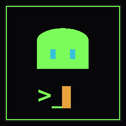

# NetGhost

**An ambient network & security terminal engine — a "networking solution for all."**
By Apoji_Delegraphics.

NetGhost is a procedural, endless, realistic-*looking* security console. It streams
fake port scans, packet captures, credential audits and syslog feeds — driven by a
seeded procedural engine — and renders them in an authentic Xterm.js terminal wrapped
in a worn, cobbled-together BBS/industrial dashboard. Run it as an interactive console,
or leave it in **Auto-Ghost** mode as a monitor display or stream backdrop.

> ### ⚠️ This is a simulation. It is not a hacking tool.
> NetGhost performs **no real network activity whatsoever**. Every IP, host, packet,
> port, and credential on screen is pseudo-randomly generated text produced locally in
> the renderer. It opens no sockets, contacts no hosts, scans nothing, and sends
> nothing. It is theatre — like a movie "hacker screen" — for displays, demos, and streams.



> **New here? Read the [full tutorial](TUTORIAL.md).**

---

## Features

- **Xterm.js terminal** — authentic emulation with a real interactive prompt (type `help`), command history (↑/↓), tab-complete, `Ctrl+C`/`Ctrl+L`.
- **Procedural engine** — seeded RNG generates subnets, hostnames (`vault-us-east-3.internal`), services/versions, CVEs, and proxy chains. Reseed any time for a fresh world.
- **Async stream generators** — `nmap` sweeps, `hydra` credential audits, `tcpdump` hex captures, `tail -f` syslog, `traceroute`, SYN-flood scrubbing, privilege-escalation chains.
- **Preset scenes** — switch the whole mood:
  - `GHOSTNET` — full-spectrum ambient drift (default)
  - `RECON` — quiet enumeration, no breaches
  - `RED-TEAM` — aggressive scan → crack → root → exfil, threat climbs fast
  - `DDoS` — defensive scrubbing console under volumetric load
  - `SOC` — calm blue-team watch floor
- **Config panel** (`Setup` / `Esc`) — scene, phosphor colour (green/amber/cyan/magenta/mono), stream **speed**, **density**, and toggles for scanlines, grime, and flicker. **Your setup is saved** and restored on next launch (`reset` to clear).
- **Plugins** — an extension system with a homebrew-style package manager. `pkg list` / `pkg install <id>` / `pkg remove <id>`; installed plugins are remembered across launches. Built-ins: `cryptominer`, `wardrive`, `scada`, `jklinger` (Kubernetes-style cluster), `hph` (n8n-style workflow automation), `coffee`. Each can add commands, scenes, themes — see `renderer/plugins.js` to write your own.
- **AI agents** (optional) — enable in Setup and paste an [OpenRouter](https://openrouter.ai) key to have analyst agents (`agent [topic]`) write live intel reports on the current telemetry. The key is stored only in local storage on your device. With AI off or offline, agents emit a procedurally-generated report instead, so the command always works.
- **Stream / OBS mode** — URL params preset and strip the UI for use as an OBS browser source: `?scene=redteam&theme=amber&speed=fast`, `?ghost=1` (auto-engage), `?kiosk=1` (terminal only, no chrome), `?transparent=1` (transparent background for an overlay). The `kiosk` command toggles chrome live; `obs` prints the list.
- **Dashboard** — proxy hop chain, live target topology, system-load meters, escalating threat matrix.
- **Fullscreen** and **multi-monitor pop-out** — spawn extra ambient monitor windows (`New Monitor Window` / the `Pop` button) and drag them to other screens.

## Commands

`help` · `scan [ip]` · `nmap <ip>` · `ping [ip]` · `trace [ip]` · `hydra [ip]` · `sniff` ·
`syslog` · `scene <id>` · `theme <id>` · `speed <id>` · `pkg <cmd>` · `agent [topic]` ·
`kiosk` · `obs` · `ghost` · `targets` · `hops` · `setup` · `reseed [n]` · `pause` · `reset` ·
`full` · `clear` · `about`

Plus any commands added by installed plugins (e.g. `mine`, `wifi`, `scada`, `jk`, `hph`, `coffee`).

## Writing a plugin

Plugins live in `renderer/plugins.js` and register through a small API:

```js
window.NetGhost.registerPlugin({
  id: "myplugin",
  name: "My Plugin",
  desc: "what it does",
  commands: { hello: (args, api) => api.wl(api.pri("hi from my plugin")) },
  scenes:   { myscene: { name:"MY SCENE", desc:"…", ops:[{ fn:()=>{}, w:3 }] } },
  themes:   { mytheme: { rgb:[255,0,128], vars:{ "--primary":"#ff0080" } } }
});
```

The engine hands every command and scene op an `api` with drawing helpers
(`wl`, `pri`, `dim`, `fg`, `amber`, `red`, …), the seeded RNG (`api.R`), the
world state (`api.W`), `api.q` to queue paced steps, and `api.pushThreat`.
Install with `pkg install myplugin`.

## Hotkeys

`Esc` config · `Ctrl+Shift+G` toggle Auto-Ghost · `Ctrl+Shift+F` fullscreen · `↑/↓` history ·
`Ctrl+C` cancel line · `Ctrl+L` clear. (Bare `G`/`F`/`Esc` also work when the terminal
isn't focused, e.g. after clicking a side panel.) Everything is also reachable via the
top-right buttons and typed commands (`ghost`, `full`, `setup`).

---

## Run from source

```bash
npm install
npm start
```

## Build installers

Uses [electron-builder](https://www.electron.build/). Output lands in `release/`.

```bash
npm run dist          # current OS
npm run dist:mac      # macOS  .dmg + .zip (universal)
npm run dist:win      # Windows NSIS installer + portable .exe
npm run dist:linux    # AppImage + .deb
```

## Cut a GitHub release

The repo ships a workflow at `.github/workflows/release.yml` that builds for macOS,
Windows and Linux and attaches the installers to a GitHub Release whenever you push a
version tag:

```bash
git tag v1.0.0
git push origin v1.0.0
```

(The workflow uses the automatically-provided `GITHUB_TOKEN`; no secrets to configure
for unsigned builds. Code-signing certificates are optional — add them as repo secrets
when you're ready to ship signed builds.)

## Project layout

```
netghost/
├─ main.js                 Electron main process (windows, menu, pop-out IPC)
├─ preload.js              safe bridge → window.netghost
├─ renderer/
│  ├─ index.html           dashboard shell + styling
│  ├─ app.js               engine: RNG, generators, scenes, terminal, config
│  └─ vendor/              bundled Xterm.js (offline, no CDN needed)
├─ build/icon.png          app icon
└─ .github/workflows/release.yml
```

## License

MIT © Apoji_Delegraphics — see [LICENSE](LICENSE).
